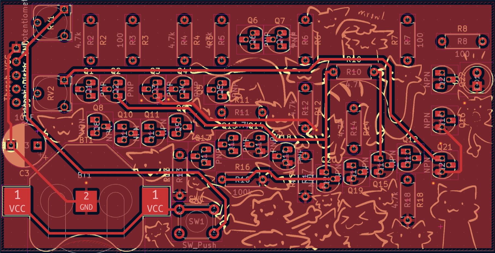
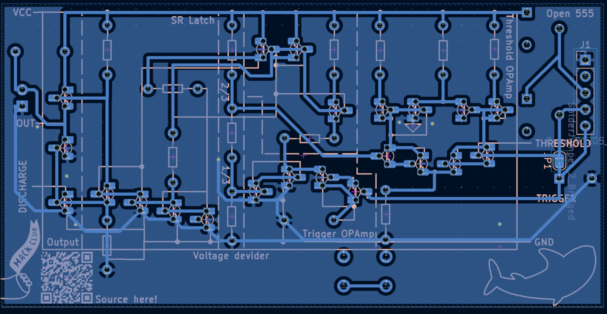
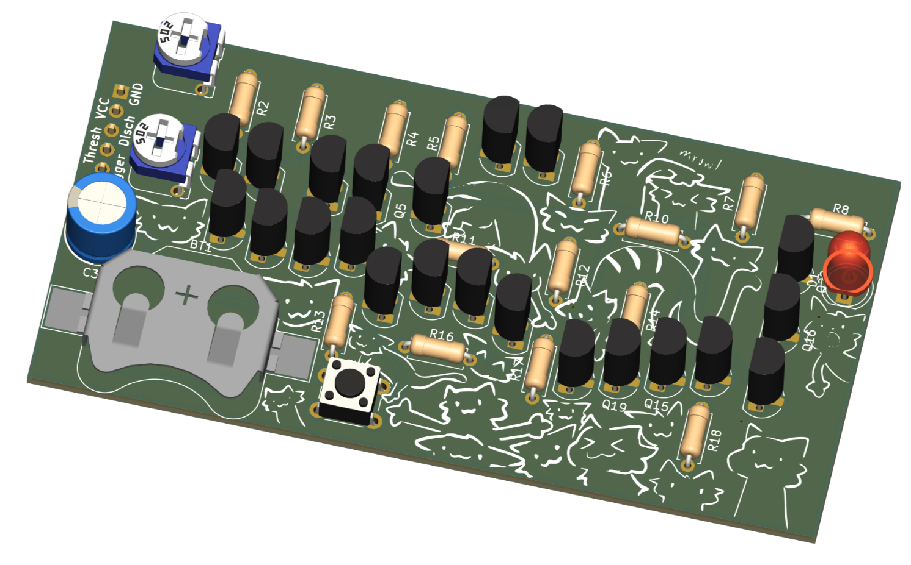

# Open555

Ever wondered how a 555 timer IC worked? Here you have it! A 555 IC, made entirely with THT transistors.

## Schematic

## PCB

## Features
- Low power design! 3V operating voltage
- On board square wave generator
- Selectable features through solder bridges
- A Schematic on the back side!
- Super cute cats on the front side - Kudos to [@acornitum](https://github.com/acornitum)

## How to build
Just order the PCB & components, open up the KiCAD file and build it accordingly.

## BOM
- 1 	Battery holder
- 1 	10uF Capacitor
- 11	PNP Transistor
- 11	NPN Transistor
- 1 	100k Resistor
- 1 	10k Resistor
- 10	4.7k Resistor
- 3 	220 Resistor
- 2 	Potentiometer
- 1 	Push Button

Made by `@Cyao` on slack :D

Made as a part of http://solder.hackclub.com/!
